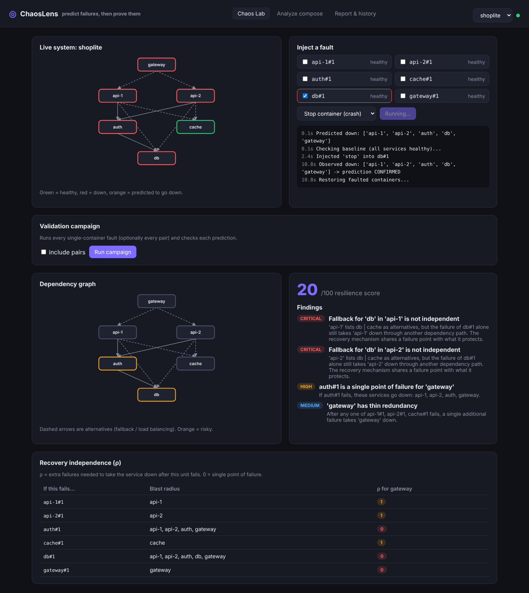

# ChaosLens

**Predict how a microservice system fails, then prove it with live chaos experiments.**

Most systems look redundant on paper: two API replicas, a cache as a fallback for the database. But a
fallback only helps if it does not share a failure point with what it protects. ChaosLens reads your
`docker-compose` setup, computes which failures would really take your system down, then injects those
failures into the running containers and checks whether the prediction was right.



## Features

- **Static resilience analysis** of any docker-compose file: single points of failure, blast radius of
  every container, and the minimum number of failures needed to break each service
- **Recovery independence degree (ρ)**: for every container failure, how many *additional* failures it
  takes to bring the entry service down (ρ = 0 means single point of failure)
- **Hidden-SPOF detection**: flags fallbacks that look redundant but share a failure path
- **Live fault injection** through the Docker Engine API: crash (`stop`) or hang (`pause`) any container
- **Prediction vs reality**: each experiment compares predicted and observed outages, streamed live to the
  dashboard over WebSockets, then restores the system automatically
- **Validation campaigns**: run every single and pairwise failure in one click and score the model
- **Resilience report**: built-in report, or an AI-written one through any OpenAI-compatible API
- Experiment history stored in SQLite; CI with GitHub Actions

## Results on the included demo (ShopLite, 6 services)

| Campaign | Experiments | Predictions confirmed |
| --- | --- | --- |
| Crash, every single container + every pair | 21 | 21 |
| Hang (pause), every single container | 6 | 6 |

ChaosLens found that ShopLite's cache fallback is useless when the database fails, because `auth`
hard-depends on the database. Every live experiment confirmed it.

## Architecture

```
React dashboard (Vite)  ──REST + WebSocket──►  FastAPI backend
                                               ├── parser.py      compose / live containers  → service model
                                               ├── model.py       AND/OR dependency rules, failure propagation
                                               ├── analyzer.py    SPOFs, blast radius, ρ, findings, score
                                               ├── chaos.py       Docker Engine API: inject / observe / restore
                                               ├── experiments.py predict → inject → observe → compare → restore
                                               ├── report.py      template or LLM resilience report
                                               └── db.py          SQLite experiment history
```

### How the model works

A service is **up** when at least one of its containers is alive **and** each of its requirement groups
has at least one healthy member. Hard dependencies come from `depends_on`. Alternatives (load balancing,
fallbacks) are declared with a label:

```yaml
labels:
  chaoslens.requires: "auth,db|cache"   # auth AND (db OR cache)
```

Failures are propagated to a fixpoint, so dependency cycles are handled. ρ is computed exactly by
searching failure sets of increasing size (fast for compose-sized systems).

### How observation works

ChaosLens reads each container's Docker health status. A service counts as down when none of its
containers is running and healthy. After injecting a fault it waits until the state is stable, compares it
with the prediction, then restarts or unpauses the faulted containers and waits for full recovery.

## Run it

Requirements: Docker with Docker Compose.

```bash
# 1. Start the demo system
docker compose -f demo/docker-compose.yml up -d --build

# 2. Start ChaosLens
docker compose up -d --build

# 3. Open http://localhost:8080
```

Optional AI reports (any OpenAI-compatible API, e.g. OpenAI, Groq, Ollama):

```bash
LLM_API_KEY=your-key LLM_MODEL=gpt-4o-mini docker compose up -d --build
```

### Local development

```bash
# backend
cd backend
pip install -r requirements.txt
uvicorn app.main:app --reload --port 8000
pytest -q

# frontend (proxies /api to :8000)
cd frontend
npm install
npm run dev
```

## API

| Method | Path | Purpose |
| --- | --- | --- |
| POST | `/api/analyze` | Analyze a compose file (`{"compose": "..."}`) |
| GET | `/api/projects` | Running compose projects |
| GET | `/api/projects/{name}` | Live model, analysis and health |
| POST | `/api/experiments` | Run a fault (`{"project", "faults": ["db#1"], "fault_type": "stop"}`) |
| WS | `/api/experiments/{id}/stream` | Live experiment events |
| POST | `/api/campaigns` | Run all single (and optionally pairwise) faults |
| GET | `/api/projects/{name}/report` | Resilience report |

## Safety

ChaosLens stops and pauses real containers. Only point it at test or staging environments. It never
injects faults into its own compose project, and it runs one experiment at a time.

## Background

Builds on my research on the *recovery independence degree*, a metric for whether a system's recovery
mechanisms are truly independent of the failures they are meant to handle.
